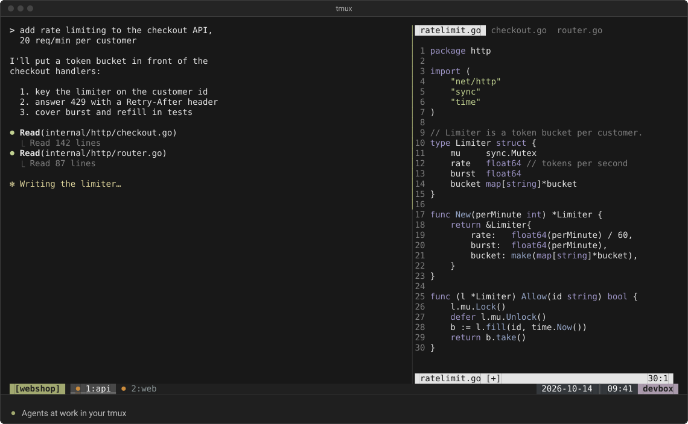
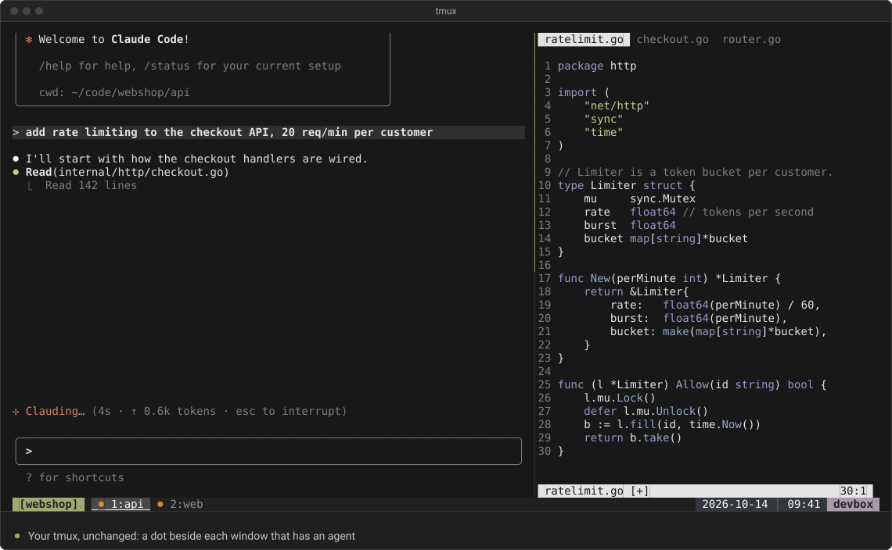
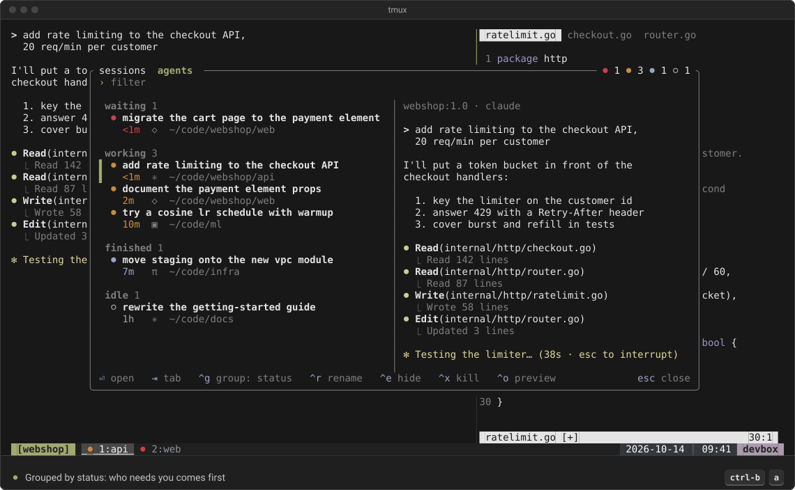
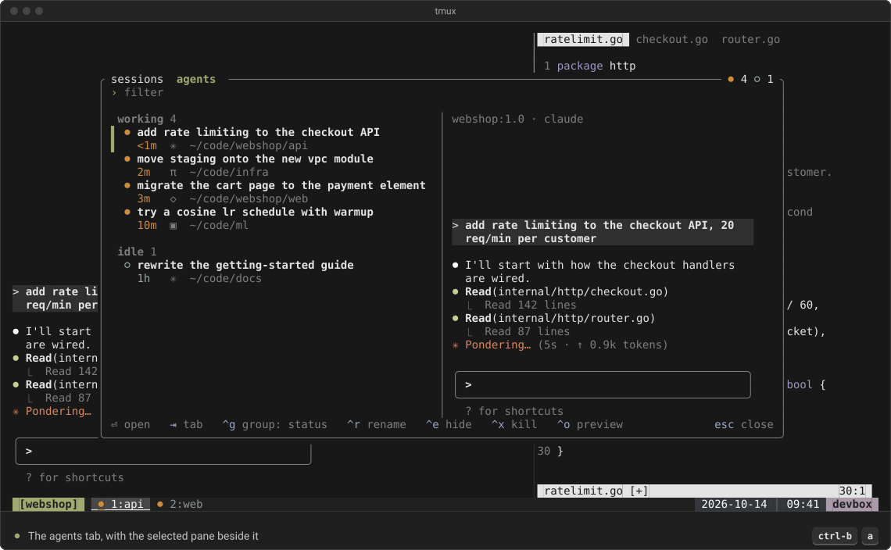
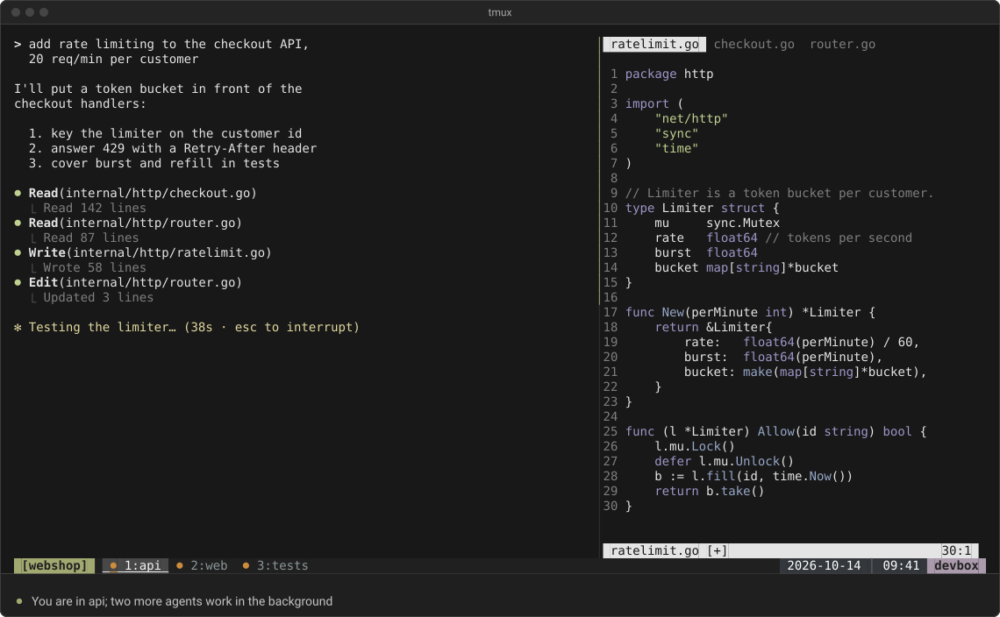
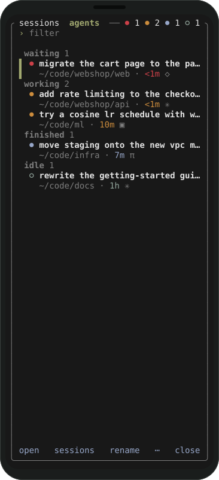

<h1 align="center">
  <picture>
    <source media="(prefers-color-scheme: dark)" srcset="docs/brand/logo-dark.svg">
    
  </picture>
</h1>

<p align="center"><b>Keep an eye on your agents without leaving tmux.</b></p>

<p align="center"><b>Stay in tmux. Add a control panel for your agents.</b></p>

<p align="center">
Keep your tmux.conf, your prefix and keybindings, your plugins and sessions.
paddock is one popup on top of them.
</p>

<p align="center"><a href="#features">Features</a> · <a href="#install">Install</a> · <a href="#use">Use</a> · <a href="#options">Options</a> · <a href="#agent-state">Agent state</a> · <a href="https://plopezlpz.github.io/paddock/">Website</a></p>

<details open>
<summary><b>Demo</b></summary>



<sub>Recorded from paddock 0.1.0 in a scratch tmux server; the sessions and agent output are staged.</sub>

</details>

A fast tmux popup for jumping between sessions, windows and panes, and for
keeping an eye on the AI coding agents running in them (Claude Code, pi,
OpenCode, …): which one is working, which is waiting for you, which has finished.

> **Status: beta.** It's used daily on macOS. Linux should work. Expect
> changes.

## Why

Your agents already run in terminals, and your terminals already live in tmux.
paddock is a popup over your panes, so you see which agents are working, which
are waiting for you and which have finished, and jump to one with a key press.

- **Your tmux.** It is a popup in the tmux you run: your config, prefix and
  plugins stay.
- **Anywhere tmux goes.** Over ssh, in any terminal: install paddock where
  tmux runs (tmux 3.8 or later).
- **On your phone.** Under 80 columns it switches to a compact layout with
  tappable words, and `@paddock-click` opens it from the session name in the
  status line.
- **One setup for agent state.** paddock's companion plugin,
  [agent-status.tmux](https://github.com/plopezlpz/agent-status.tmux), listens
  to your agents' own hooks. Add both and you get the status bar dots, the
  desktop notifications and paddock's agents tab, with no daemon and no
  polling. paddock doesn't start or wrap your agents; they run in your panes as
  they do today. Agents without lifecycle hooks, such as Codex, are not
  covered (see [Agent state](#agent-state)).

[herdr](https://herdr.dev) is an agent runtime: its own server that keeps your
agents' terminals alive, with its own TUI, CLI and API, and a good home if you
are starting fresh. [cmux](https://cmux.com) is a native macOS terminal built
around agents. If your home is already tmux, paddock brings an at-a-glance view
to it, with no new server, terminal or config to move to.

## Features

### A dot beside each window that has an agent

Your status bar stays as it is; agent-status.tmux adds one dot to each window
that has an agent, for working, finished or asking you something, and paddock
shows the same state.



### Open paddock, jump to the agent that needs you

`prefix a` opens a popup over whatever you were doing. `Tab` shows every agent,
the one that needs you first, and `Enter` jumps to its pane. Start typing to
filter sessions, windows and agents with a fuzzy filter (`'exact`, `^prefix`,
`suffix$`, `!not`). That is the demo above.

### Group agents

Agent cards group by status, session or folder, or not at all (`ctrl-g`);
within a state, the most recent change comes first. Grouped by folder, agents
working in the same project, one per worktree, sit together.



### Skim agents without jumping to them

The selected pane, live, beside the list, when the popup is at least 102
columns wide (`ctrl-o` toggles it). Move down the list and the preview follows,
so you can read what an agent is doing, or asking, before you jump to it.



### Rename an agent, with a suggested title

`ctrl-r` renames the selected agent in place; press it again and paddock fills
in a suggested title when agent-status.tmux offers one, to keep, edit or drop.
`Enter` saves it, `ctrl-z` undoes it.

### Sessions, windows and panes from the popup

New, rename, move, kill and undo, without leaving the popup: rename sessions,
windows and agents; move windows and panes; kill sessions, windows and panes;
create windows and sessions. Click, double-click, drag and a right-click menu
work too; tabs and footer hints are buttons.

### Know when an agent needs you

A red dot in the status bar means an agent is waiting for you, and in paddock
it is the first card. agent-status.tmux can also raise a clickable desktop
notification.



### On your phone

Under 80 columns paddock switches to a compact two-line layout with tappable
words (see [Use](#use)).

<p align="center">
  
</p>

### Your colours

Colours follow `@paddock-color-*`, else your tmux theme and `@agent-color-*`,
else the defaults (see [Options](#options)).

It uses one tmux control-mode connection and redraws only when something
changes.

## Install

You need tmux 3.8 or later (`tmux -V`); distribution packages are usually
older. Prebuilt binaries cover macOS and Linux, arm64 and x86_64. For agent state
add the companion plugin [agent-status.tmux](#agent-state) too: the TPM snippet
below includes it, and with Homebrew or cargo you add it as in
[its README](https://github.com/plopezlpz/agent-status.tmux).

### TPM

With [TPM](https://github.com/tmux-plugins/tpm), in `~/.tmux.conf` (set the
options before the plugin loads):

```tmux
set -g @paddock-key 'a'          # prefix a opens paddock
set -g @plugin 'plopezlpz/paddock'
set -g @plugin 'plopezlpz/agent-status.tmux'   # agent state: dots, notifications
```

Press `prefix I`, then the key. It offers to download the matching binary
from the GitHub release (checksum verified); press the key again. No Rust
needed. After `prefix U`, the key offers the new version. Outside tmux, run
`bash ~/.tmux/plugins/paddock/scripts/install.sh` (TPM may use
`~/.config/tmux/plugins/` instead).

### Homebrew

```sh
brew install plopezlpz/tap/paddock
```

```tmux
set -g @paddock-key 'a'
run-shell 'paddock init'
```

If tmux's `PATH` lacks Homebrew's, write out the full path,
`$(brew --prefix)/bin/paddock`: `/opt/homebrew/bin/paddock` (Apple silicon),
`/usr/local/bin/paddock` (Intel Mac), `/home/linuxbrew/.linuxbrew/bin/paddock`
(Linux).

After `brew upgrade`, reload tmux; until then the key says its bindings are
for another version.

### From source

Needs Rust 1.88+.

```sh
cargo install --locked --git https://github.com/plopezlpz/paddock
```

```tmux
set -g @paddock-key 'a'
run-shell '~/.cargo/bin/paddock init'
```

(`cargo install paddock` will work once it is on crates.io.) Reload tmux
after `cargo install` too.

### From a clone

For development. Clone it anywhere, run `cargo build --release`, and use
`run-shell '<clone>/paddock.tmux'` in place of the `@plugin` line.
paddock.tmux binds the clone's build, else a `bin/paddock` it downloaded, and
only if that reports the plugin's version; otherwise the key offers the
download. `PADDOCK_BIN` overrides the choice, set inline (an exported variable
does not reach a running tmux server):
`run-shell 'PADDOCK_BIN=/path/to/paddock <clone>/paddock.tmux'`.

## Use

- **Sessions tab**: session › window › pane tree with each window's agent state.
- **Agents tab**: one card per agent, grouped by status, session or folder; it opens on the agent you are in.
- **Preview**: the selected pane, live, when the popup is at least 102
  columns wide.
- **Phones**: under 80 columns, a compact two-line layout with tappable words.

| Key | Action |
|---|---|
| type | fuzzy filter (`'exact`, `^prefix`, `suffix$`, `!not`); `Backspace` or `ctrl-h`, `ctrl-w`, `ctrl-u` edit it |
| `↑` `↓`, `ctrl-p` `ctrl-n` (`ctrl-k` `ctrl-j`), PageUp/PageDown | move |
| `Enter` | jump there (a zoomed window stays zoomed) |
| `Tab` | switch tabs |
| `→` / `←` | show or hide a window's panes |
| `ctrl-r` | rename the selected session, window or agent, in place |
| `shift-↑` `shift-↓` | move the selected window or pane past its neighbour (at the ends, into the next session or window) |
| `ctrl-t` | move the selected window or pane: pick a spot (arrows or the filter), `Enter` drops it there |
| `ctrl-x`, `Delete` | kill the selected session, window or pane, after saying what runs there (`Enter` or `ctrl-x` again) |
| `ctrl-s` | new window after the selected one (last in a selected session), in its folder; `ctrl-s` again: a new session instead |
| `ctrl-z` | undo the last rename or move |
| `ctrl-g` | change the agents' grouping |
| `ctrl-o` | toggle the preview |
| `Esc`, `ctrl-c` | back out: close a menu, cancel a rename, move, new name or question, else close |

Renaming edits the name in place, with `←` `→`, `Home` `End` (`ctrl-a`
`ctrl-e`), `ctrl-w` and `ctrl-u`. `Enter` saves. An empty window name hands
naming back to tmux, and an empty agent title goes back to the automatic one;
for an agent, `ctrl-r` again fills in a suggested title when agent-status.tmux
offers suggestions (see below), to keep, edit or drop.

Dropped on a session, a window goes first in it; on a window, after it. A
pane dropped on a window joins it, on a pane splits beside it (or swaps, in
its own window), and on a session becomes a window of its own. Moving a
session's last window out closes the session, so paddock asks first.

A new window or session is named on its own row, where it will appear in
the tree. `Enter` creates it and goes there; a window left unnamed is named
after what runs, like tmux's own.

Mouse and touch: click to select, double-click to open (on a phone, tap the
selected row). Click ▸ to show a window's panes. Drag a window or pane to
move it. Right-click (or ctrl-click) opens the row's menu of everything you
can do with it. Tabs and footer hints are buttons; when the footer runs out
of room, ⋯ opens the menu.

## Options

| Option | Default | |
|---|---|---|
| `@paddock-key`, `@paddock-agents-key` | unset | keys that open paddock on the tab it was last closed on, and on the agents tab |
| `@paddock-click` | unset | `on`: a click on the session name (status-left) opens paddock, handy on a phone; needs `set -g mouse on` |
| `@paddock-popup-width`, `@paddock-popup-height` | `80%` | may be a format, e.g. `#{?#{e\|<:#{client_width},140},100%,80%}` |
| `@paddock-popup-style` | `bg=terminal,fg=terminal` | popup background and text |
| `@paddock-color-accent` | `pane-active-border-style` fg, else yellow | selection, active tab |
| `@paddock-color-muted`, `-hint`, `-border` | dim, blue, muted | secondary text, key hints, frame |
| `@paddock-color-asking`, `-working`, `-finished`, `-idle` | `@agent-color-*`, else red, yellow, cyan, green | agent dots |

## Agent state

paddock's companion plugin,
[agent-status.tmux](https://github.com/plopezlpz/agent-status.tmux), listens to
your agents' own hooks and keeps their state on each agent's pane. Add both and
you get the status bar dots, the desktop notifications and paddock's agents
tab. Without it, paddock is a session switcher with a live preview.

agent-status.tmux supports pi, OMP, OpenCode, Kimi Code, MastraCode, Kilo Code
(partial) and Claude Code; see [its README](https://github.com/plopezlpz/agent-status.tmux#providers).

Any tool can feed paddock by setting these options on the agent's pane
(one agent per pane, one tool setting them per tmux server):

| Pane option | Value |
|---|---|
| `@agent-state` | `working`, `asking` or `idle` |
| `@agent-unseen` | `1` when an idle agent finished a turn you haven't looked at |
| `@agent-stale` | `1` when the state hasn't been confirmed recently (shown with a `?`, e.g. `working?`) |
| `@agent-kind` | the agent's name, e.g. `claude` |
| `@agent-auto-description` | an automatic title, e.g. the first prompt |
| `@agent-state-at` | when the state last changed, in Unix seconds |

Only `@agent-state` is required. The tool that sets them:

- **unsets** them all when the agent exits, along with `@agent-description`
  (below). A pane without `@agent-state` has no agent.
- **clears** `@agent-unseen` when the pane gets focus, from a `pane-focus-in`
  hook. Jumping there from paddock fires it. tmux sends focus events only
  with `focus-events on` (its default is off).

A pane whose `@agent-state` paddock doesn't know is shown without an agent.

An agent's title is its `@agent-description`, the title you gave it, else
`@agent-auto-description`, else the pane title the agent set (without status
glyphs such as `✳`; tmux's default, the host name, is not a title).
Renaming sets `@agent-description` on the pane; clearing it unsets it.

For suggested titles, a tool sets the global `@agent-suggest-command` to
a shell command. paddock runs it with the pane id appended, in its own
process group, and stops it when you cancel, type over it, or after 30
seconds. It prints the title on stdout, or fails with the reason as the last
line of stderr. agent-status.tmux's is `describe.sh suggest`, which asks pi
from the agent's conversation.

## The `_paddock` session

While open, paddock is attached to tmux as a control client. So that it never
becomes the "current client" of your sessions, it attaches to a session of its
own, `_paddock` (one idle `cat`), which exists only while the popup is open.
paddock hides it; `tmux ls` and `choose-tree` show it meanwhile.

The `client-attached`, `client-detached` and other client hooks are emptied
on that session, so yours don't run when the popup opens or closes. Global
`client-created`, `session-created` and `session-closed` hooks still do.

A tmux command run from outside tmux without `-c` or `-t` may still pick
paddock's client while the popup is open.

## License

[MIT](LICENSE)
