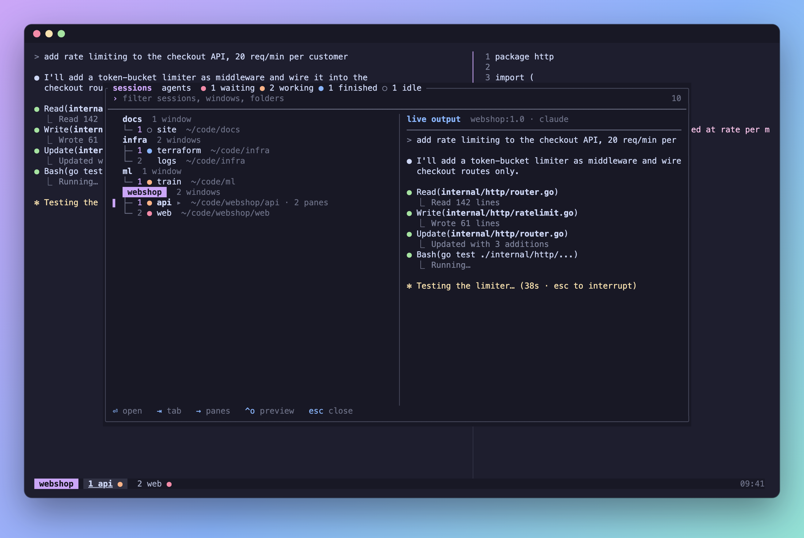
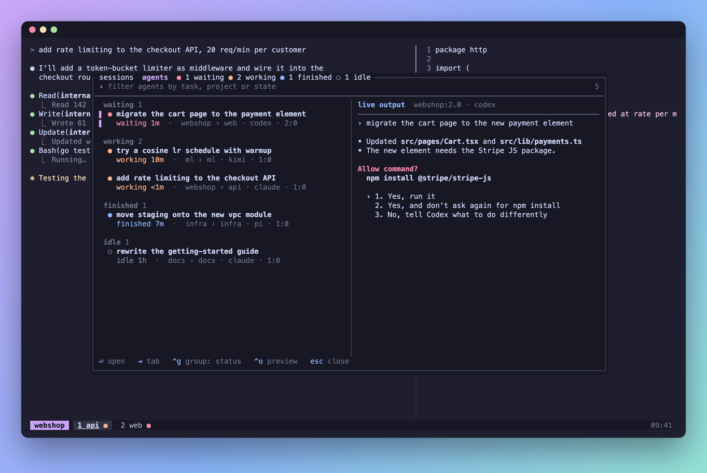

# paddock

A fast tmux popup for jumping between sessions, windows and panes, and for
keeping an eye on the AI coding agents running in them (Claude Code, Codex,
pi, …): which one is working, which is waiting for you, which has finished.

It uses one tmux control-mode connection and redraws only when something
changes.




> **Status: prototype.** It's used daily on macOS. Linux should work. Expect
> changes.

## Install

You need tmux 3.8+ and Rust 1.88+.

With [TPM](https://github.com/tmux-plugins/tpm), in `~/.tmux.conf` (set the
options before the plugin loads):

```tmux
set -g @paddock-key 'C'          # prefix C opens paddock (replaces customize-mode)
set -g @plugin 'plopezlpz/paddock'
```

Press `prefix I`, then build once and reload tmux:

```sh
cd ~/.tmux/plugins/paddock && cargo build --release
```

Without TPM, clone it anywhere, build it, and use
`run-shell '<clone>/paddock.tmux'` instead of the `@plugin` line. If the
clone has no build, paddock uses a `paddock` binary from `PATH` or
`~/.cargo/bin`. Rebuild after updating.

## Use

- **Sessions tab**: session › window › pane tree with each window's agent state.
- **Agents tab**: one card per agent, grouped by status, session or folder.
- **Preview**: the selected pane, live, when the popup is at least 102
  columns wide.
- **Phones**: under 80 columns, a compact two-line layout with tappable words.

| Key | Action |
|---|---|
| type | fuzzy filter (`'exact`, `^prefix`, `suffix$`, `!not`) |
| `↑` `↓`, `ctrl-p` `ctrl-n`, PageUp/PageDown | move |
| `Enter` | jump there (a zoomed window stays zoomed) |
| `Tab` | switch tabs |
| `→` / `←` | expand or collapse a window's panes |
| `ctrl-g` | change the agents' grouping |
| `ctrl-o` | toggle the preview |
| `Esc` | close |

Mouse and touch work too: tap to select, tap again to open. Tabs and footer
hints are buttons.

## Options

| Option | Default | |
|---|---|---|
| `@paddock-key`, `@paddock-agents-key` | unset | keys that open the sessions and agents tabs |
| `@paddock-popup-width`, `@paddock-popup-height` | `80%` | may be a format, e.g. `#{?#{e\|<:#{client_width},140},100%,80%}` |
| `@paddock-popup-style` | `bg=terminal,fg=terminal` | popup background and text |
| `@paddock-color-accent` | `pane-active-border-style` fg, else yellow | selection, active tab |
| `@paddock-color-muted`, `-hint`, `-border` | dim, blue, muted | secondary text, key hints, frame |
| `@paddock-color-asking`, `-working`, `-finished`, `-idle` | `@agent-color-*`, else red, yellow, cyan, green | agent dots |

## Agent state

paddock displays agent state; something else produces it.
[agent-status.tmux](https://github.com/plopezlpz/agent-status.tmux) does,
by hooking into each agent. Without a producer, paddock is a session switcher
with a live preview.

Any producer can feed paddock by setting these options on the agent's pane
(one agent per pane):

| Pane option | Value |
|---|---|
| `@agent-state` | `working`, `asking` or `idle` |
| `@agent-unseen` | `1` when an idle agent finished a turn you haven't looked at |
| `@agent-stale` | `1` when the state hasn't been confirmed recently (shown as `working?`) |
| `@agent-kind` | the agent's name, e.g. `claude` |
| `@agent-description` | what the agent is working on |
| `@agent-state-at` | when the state last changed, in Unix seconds |

Only `@agent-state` is required. A producer:

- **unsets** them all when the agent exits. A pane without `@agent-state` has
  no agent.
- **clears** `@agent-unseen` when the pane gets focus, from a `pane-focus-in`
  hook. Jumping there from paddock fires it.

A pane whose `@agent-state` paddock doesn't know is shown without an agent.
agent-status.tmux's `@agent-auto-description` is read when
`@agent-description` is unset, and its description overrides
(`@agent-descriptions-dir`, `@agent-revision`) when it sets them.

## The `_paddock` session

While open, paddock is attached to tmux as a control client. So that it never
becomes the "current client" of your sessions, it attaches to a session of its
own, `_paddock` (one idle `cat`), which exists only while the popup is open.
paddock hides it; `tmux ls` and `choose-tree` show it meanwhile.

The `client-attached`, `client-detached` and other client hooks are emptied
on that session, so yours don't run when the popup opens or closes. Global
`client-created`, `session-created` and `session-closed` hooks still do.

A tmux command run from outside tmux without `-c` or `-t` may still pick
paddock's client while the popup is open.

## License

[MIT](LICENSE)
